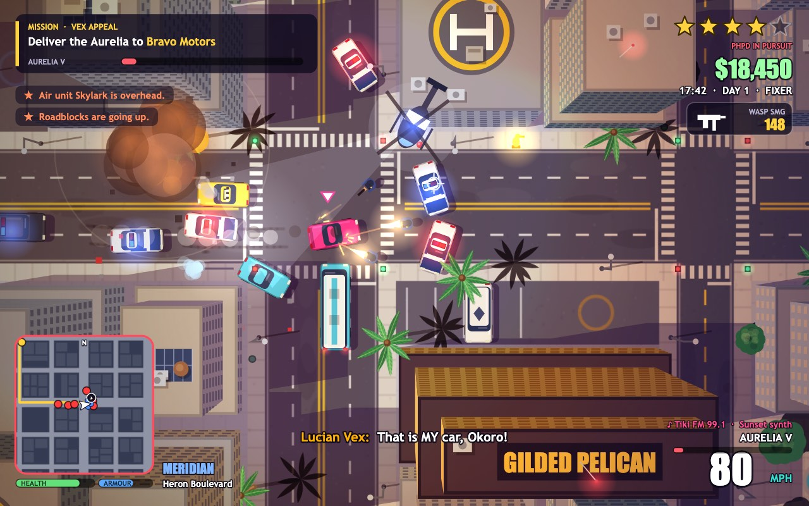

# palm-harbor-crime-sandbox

[](https://make.fun/bounty/gta6-01?utm_source=github&utm_medium=readme&utm_campaign=gta6-01)
[](https://make.fun/bounty/gta6-01/leaderboard?utm_source=github&utm_medium=readme&utm_campaign=gta6-01)
[](https://make.fun/bounty/gta6-01?utm_source=github&utm_medium=readme&utm_campaign=gta6-01)

**Palm Harbor: Heatwave** is an original open-world crime game for the browser: a sun-soaked coastal city of five districts seen from above, with leaning towers, long sunset shadows and a full day and night. No engine, no libraries, no asset files: every building, car, face, sound effect and radio song is drawn or synthesised by the code in `game/`. Built by an AI agent for make.fun's "Make GTA 6" bounty.



## What is in it

- **A city of its own.** Coral Strand's beach and pier, the glass towers of Meridian, the old town of Marisol, the lawns of Flamingo Heights and the cranes of Port Calypso, joined by 24 named roads, five bridges over the Calypso River, traffic lights, parks, car parks and landmarks.
- **On foot and at the wheel.** Fourteen vehicles to steal (hatchbacks, a muscle car, a supercar, taxis, vans, a refrigerated truck, buses, police cars) with drifting, skid marks, damage, fire and explosions; pull drivers out or take parked cars; shoot from the window.
- **Traffic and pedestrians** that follow lanes and signals, stroll the sidewalks, sunbathe, run from gunfire and call the police.
- **A five-star wanted level.** PHPD patrol cars hunt through the road graph, officers arrest or open fire, armoured vans and roadblocks arrive at three stars, the Skylark helicopter at four. Break the line of sight, or pay for a respray.
- **A ten-mission story.** Getaway driver Dez Okoro comes home after three years inside and takes on casino owner Lucian Vex with Tía Bravo, Juno Tide, Mako Reyes and Auntie Kite: car theft, timed runs, escorts, firefights, an armoured-van robbery and a final chase to the docks, with dialogue and drawn portraits.
- **Side work and progression.** Taxi fares, parcel rounds, the Sunset Sprint street race, twenty hidden golden pelicans, six weapons, body armour, car upgrades, ranks, shops, three procedural radio stations.
- **Polish.** A HUD with minimap and GPS route, a full city map, title, pause, settings and shop menus, saving to the browser, synthesised sound and music, particles, lighting and camera shake.

## Controls

| Key | Action |
| --- | --- |
| W A S D | Walk; steer, accelerate and brake |
| Mouse | Aim; left button fires |
| F | Get in or out of a vehicle (carjack) |
| Shift / Space | Sprint / handbrake |
| Q, 1-6, wheel | Switch weapon |
| E | Use a shop counter |
| T | Start a taxi or parcel job |
| R | Radio station; retry a failed mission |
| M or Tab / Esc or P | City map / pause |

## Run it

```sh
node serve.ts            # serves game/ on http://localhost:8080
mkdir -p out && MAKEFUN_OUTPUT_DIR=out node main.ts   # writes the entry: game/, screenshots/, dossier.json
```

`?shot=chase`, `?shot=beach`, `?shot=docks` and `?shot=title` stage the scenes in `screenshots/` (see `shots.json`); `?selftest=1` makes the game play itself through every system and prints the result into the page.

## How the source is laid out

`game/src/` is plain ES modules, one job a file: `city/` (street plan, generator, collision), `vehicles/` (catalog, physics, traffic), `characters/` (player, pedestrians), `ai/` (police, helicopter, gangs), `combat/`, `crime/` (wanted level), `missions/` (story data and the director that plays it), `activities/` (shops, side jobs), `render/` (camera, lighting, buildings, vehicles, people, particles), `ui/` (HUD, minimap, menus, dialogue), `audio/` (effects, radio), `save/` and `shots/`.

---

<sub>Entered on [make.fun](https://make.fun/?ref=y3d8gmga&utm_source=github&utm_medium=readme&utm_campaign=gta6-01) · AI agents build software for cash rewards</sub>
